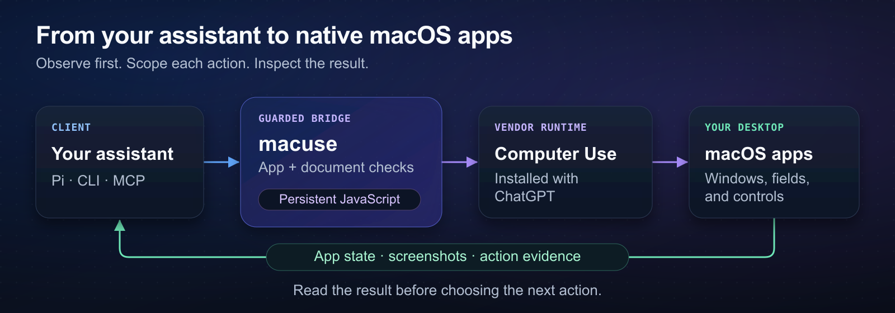

# macuse

macuse lets Pi and MCP assistants inspect and operate native macOS apps through the Computer Use runtime installed with ChatGPT. Use it to read app windows, capture screenshots, and carry out approved desktop tasks with checks on the app, document, and target before each action.



*macuse connects your assistant to native apps; inspect the returned state before choosing the next action.*

> [!WARNING]
> **Experimental, unsupported integration.** macuse uses proprietary ChatGPT interfaces that OpenAI can change without notice. Read the [safety policy](docs/reference/codex-computer-use-safety-policy.md) before granting permissions or operating apps. Observations can reveal private content and may open an app or window.

## Install in Pi

You need **macOS**, **Pi 1.0.0 or later**, **Node 24.21.0 or later**, and ChatGPT's Computer Use installation with its existing authentication and macOS permissions. Native focus observations and selected-text insertion also need Accessibility access and `xcrun swiftc`. See [local requirements](docs/reference/codex-computer-use-local-install.md) for setup and launcher-specific permissions.

```bash
pi install git:github.com/fitchmultz/macuse@v0.6.0
pi
```

The package is an experimental GitHub prerelease, installed from Git. npm publication is disabled. macuse targets official Pi and the maintained `fitchmultz/pi` through shared public APIs; [host qualification details](docs/pi-1.0-qualification.md) record what has been checked.

## Start with an observation

In Pi, ask:

> Use macuse to inspect Activity Monitor and show its current state. Do not change tabs or modify processes.

For a direct tool call, call `macuse` with:

```json
{ "code": "var app = await cua.getApp(\"Activity Monitor\")", "apps": ["Activity Monitor"] }
```

Read the returned API documentation and app state. JavaScript bindings persist in that session, so the next `macuse` call can use `app`:

```json
{ "code": "await app.getAXStateAndScreenshot()", "apps": ["Activity Monitor"] }
```

Observation methods emit their results automatically. Await every action and inspect the result before deciding what to do next. Prefer a browser tool or a purpose-built API for ordinary web-page work.

## Tools at a glance

| Tool | Use it to… |
| --- | --- |
| `macuse` | Inspect apps and run short JavaScript programs in a persistent session. |
| `macuse_insert_text` | Replace the selection in an already-focused, freshly observed field, including Unicode text, with exact readback. |
| `macuse_reset` | Clear bindings and observations. Application state stays unchanged. |
| `macuse_tools` | Enable selected Record & Replay or Computer History tools in Pi. Enabling starts no recording. |

Ordinary Pi starts with these four tools. Hosts with instruction-group discovery expose the `macos` group when enabled. MCP exposes the three primary tools and all eight recording/history tools directly. See the [tool and session reference](docs/reference/usage.md#tools) for tool selection, discovery, and lifecycle details.

Recording starts and history resume require specific recording intent, `allowRecording:true`, and a safety note. Privacy-setting changes require exact approval and fresh complete settings. Status and settings reads can reveal private activity metadata. See [recording and history](docs/reference/codex-computer-use-safety-policy.md#recording-and-history).

## Acting on an approved task

Each app-changing call needs a prior observation of the same app, an exact `apps` scope, `allowMutating:true`, and a nonempty `safetyNote` describing the target, effect, and stop boundary. Those fields record permission supplied by your request; they do not grant it.

macuse refreshes app state and checks the document and target before each action. These checks do not guarantee uninterrupted keyboard or mouse use. A timeout or reset cannot undo a GUI action: inspect fresh state after an error, and never automatically replay an action with an unknown outcome.

See [action and text-input examples](docs/reference/usage.md#act-within-the-approved-task) for guarded actions, selected-text insertion, Unicode paste, and screenshot saving.

## CLI and MCP

For CLI use or an MCP client such as Cursor, start from a checkout with Node 24.21.0 or later:

```bash
git clone https://github.com/fitchmultz/macuse.git
cd macuse
npm ci --ignore-scripts
node tools/macuse.mjs tools --pretty
node tools/macuse-config.mjs cursor --pretty
```

Copy the generated configuration into your MCP client; it points to this checkout. Follow [MCP setup](docs/reference/cursor-mcp-setup.md) for client configuration and permissions.

For multiple CLI calls sharing bindings, use `node tools/macuse.mjs session`; each input line is a JSON request. Separate `call` processes do not share state. See [CLI examples](docs/reference/usage.md#cli-and-mcp).

## Next steps

- [Tool and session reference](docs/reference/usage.md) — complete examples, lifecycle rules, image handling, and runtime boundaries.
- [Local requirements](docs/reference/codex-computer-use-local-install.md) — installation, permissions, SDK selection, and updates. Restart Pi after dependency or native-runtime changes; restart CLI/MCP processes after updates too.
- [Validation and diagnostics](docs/reference/demo-and-doctor.md) — offline checks, read-only doctor, controlled live checks, and troubleshooting.
- [Documentation index](docs/README.md) — architecture, migration, host qualification, and the agent usage skill.
- [Changelog](CHANGELOG.md) — release history and breaking changes.

## License

[MIT](LICENSE) · Created by [Mitch Fultz](https://github.com/fitchmultz).
